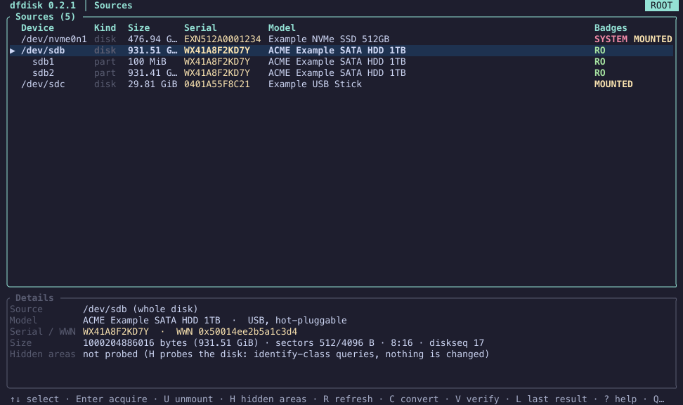
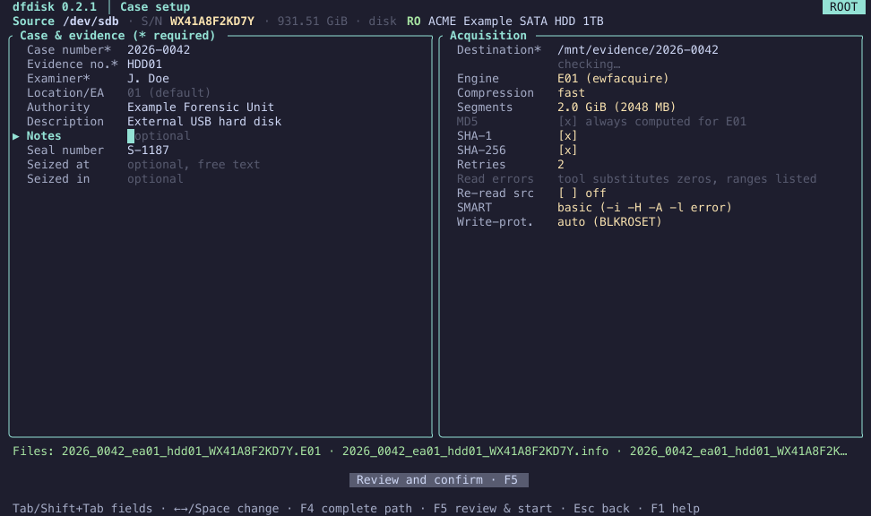
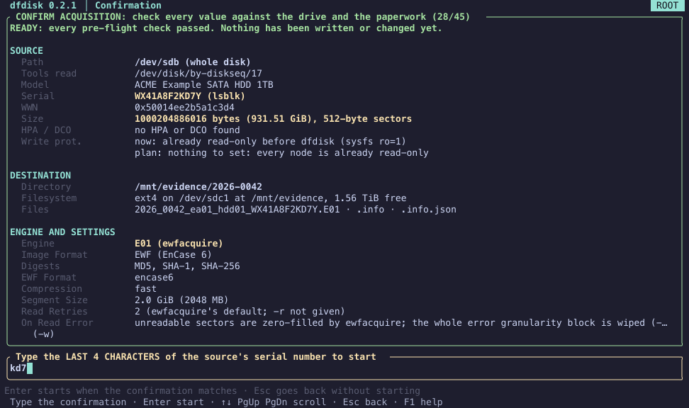
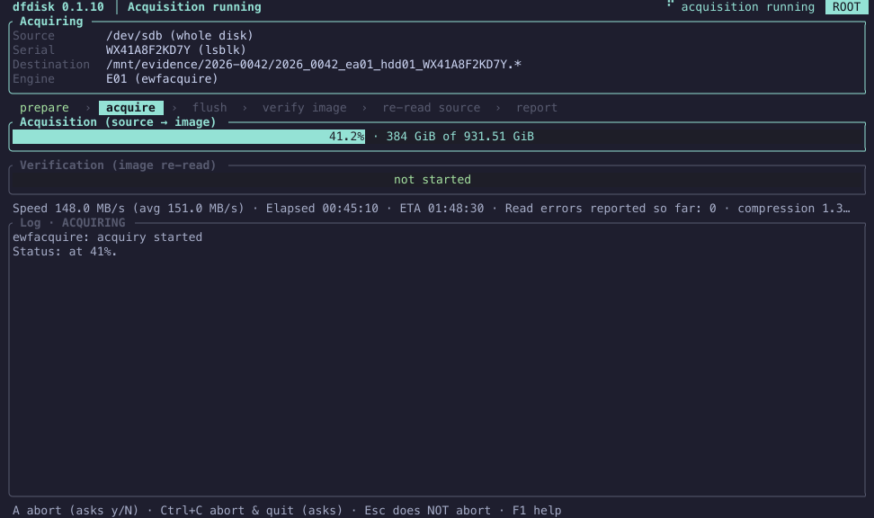
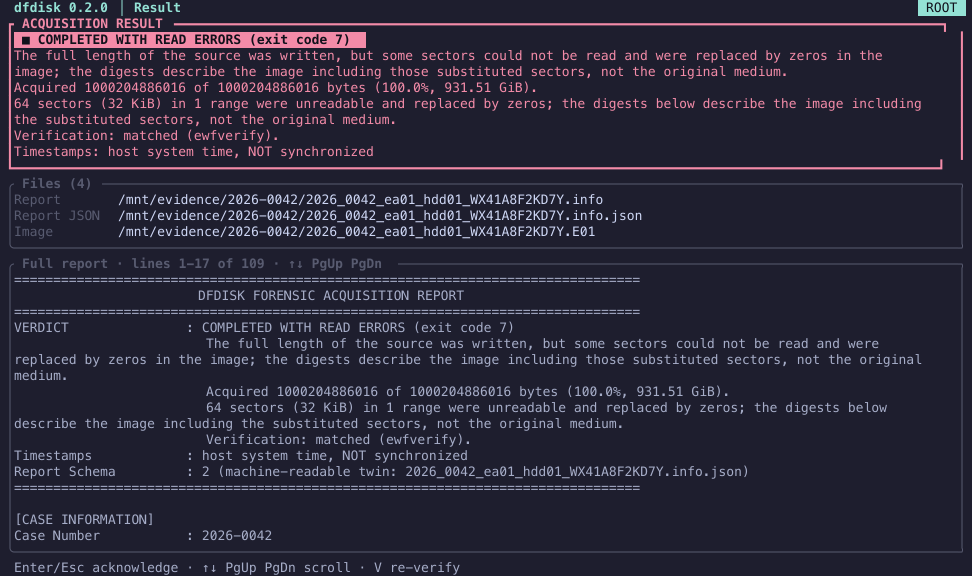

# dfdisk

<p align="center">
  <a href="https://github.com/tylerstyle/dfdisk/releases/latest">
    
  </a>
  <a href="https://github.com/tylerstyle/dfdisk/actions/workflows/ci.yml">
    
  </a>
  <a href="https://ratatui.rs/">
    
  </a>
  <a href="https://github.com/nix-community/NUR">
    
  </a>
  <a href="#license">
    
  </a>
</p>

dfdisk is a forensic disk imager for Linux with an interactive terminal UI and a
scriptable command line. It acquires a storage device into an E01 image (through
libewf's `ewfacquire`), a RAW image (read and hashed by dfdisk itself) or, for
damaged media, a RAW image through GNU ddrescue. Every acquisition ends with a
text report and a JSON report whose verdict and exit code state exactly what was
acquired and what was verified, including every range that could not be read.

dfdisk is part of the df-suite: [dfcore](https://github.com/tylerstyle/dfcore)
(the shared safety core), dfmount, dfnet and the dfnix forensic live system. It
runs on any Linux host; on dfnix it also honours the boot-time protected-device
registry and writes to the hash-chained dfnix audit log.

> **0.2.0 is a breaking release**: case, evidence and examiner are required, the
> exit codes and the report format changed. See [CHANGELOG.md](CHANGELOG.md).

## Contents

- [What dfdisk does](#what-dfdisk-does)
- [What dfdisk does not do](#what-dfdisk-does-not-do)
- [Installation](#installation)
- [Usage](#usage)
- [Exit codes](#exit-codes)
- [Reports and output files](#reports-and-output-files)
- [Safety model](#safety-model)
- [Screenshots](#screenshots)
- [Development](#development)
- [License](#license)
- [Disclaimers](#disclaimers)

## What dfdisk does

### Three acquisition engines

| Engine | Selected with | Output | Digests | Unreadable sectors |
|--------|---------------|--------|---------|--------------------|
| E01 | `--format e01` (default) | `<base>.E01`, `.E02`, … written by `ewfacquire` (compression and segment size selectable) | MD5 always, SHA-1 and SHA-256 selectable; verified with `ewfverify` | ewfacquire replaces them with zeros; dfdisk takes the exact ranges from the error list stored in the image (`ewfinfo -e`) and from ewfacquire's output |
| RAW | `--format raw` | `<base>.raw`, one file | MD5, SHA-1, SHA-256 computed by dfdisk while reading, plus a piecewise SHA-256 per `--piece-size` (default 1 GiB); the image is re-read and hashed again | `--on-read-error stop` (default): stop at the first unreadable sector, report its exact offset, verdict INCOMPLETE; `--on-read-error zero-fill`: replace each unreadable sector by zeros, record every range, continue |
| Rescue | `--rescue` | `<base>.raw` and the ddrescue mapfile `<base>.map` | computed from the image after the rescue; `--verify-source` reads the source a second time and compares | taken from the ddrescue map: bad sectors are zeros in the image, untried or unfinished areas make the run INCOMPLETE; a rescue can be resumed on the same device |

`--rescue-to-e01` converts a finished rescue image into an E01 next to it and
puts the read-error summary of the rescue (and its zero-filled sector ranges)
into the E01 notes and the conversion report, which references the rescue
report by path and SHA-256. `dfdisk convert` converts RAW to E01 and E01 to RAW
with the same checks and a report of its own.

### A verdict you can rely on

The verdict comes from one function over the facts the run measured; the engines
never choose it.

| Verdict | Exit code | Meaning |
|---------|----------:|---------|
| VERIFIED | 0 | complete, no read errors, the image re-read digests equal the digests computed while reading the source |
| COMPLETE, NOT VERIFIED | 9 | complete, no read errors, but nothing independent to compare with (rescue without `--verify-source`) |
| COMPLETED WITH READ ERRORS | 7 | full length written, some sectors unreadable and replaced by zeros; the digests describe the image with the zeros, not the medium |
| INCOMPLETE | 6 | not all of the source was acquired (stopped early, untried areas, source lost or changed, destination full) |
| HASH MISMATCH | 5 | a recomputed digest differs (image, or a second read of the source) |
| VERIFICATION FAILED | 4 | the verification could not run or complete |
| ABORTED | 8 | stopped by the examiner or a signal; partial output and report are kept |

"ALL HASHES MATCH" is printed only for VERIFIED. Images are fsynced and dropped
from the page cache (POSIX_FADV_DONTNEED) before they are verified, so the
verification reads them back from the destination rather than from memory; the
RAW engine re-reads with `O_DIRECT` where the filesystem supports it.

### Evidence handling

- Required case fields: case number, evidence number and examiner. Optional:
  EA/location (default `01`), authority, description, notes, seal number, seizure
  time and seizure location. No placeholder is ever recorded; the E01 header and
  the report hold the same values; missing optional values read "(not provided)".
- File names follow `{case}_{ea}_{evidence}_{serial}` (for example
  `vg_2026_4192_ea01_ssd01_EXS970A0004192E.E01`); names longer than 255 bytes are
  refused, never truncated, and existing outputs are never overwritten.
- The report records the source identity with the origin of its serial number,
  write protection, hidden areas (HPA/DCO), SMART before (and after a rescue),
  applied settings, timestamps with the clock's NTP state and RTC offset, every
  read-error range, all digests, every external command run with its exit status,
  the versions of dfdisk, dfcore and the tools, and the audit anchor.
- `dfdisk verify` re-checks an image later (against digests given on the command
  line, a report, the digests stored in an E01, or a piecewise hash file) and
  writes an addendum next to the image instead of changing the report.

## What dfdisk does not do

- No AFF4 output, and RAW images are never split into segments (use E01 for
  segmented images).
- It does not remove or change HPA/DCO areas; it reports them (and refuses with
  `--refuse-hidden-areas`). An image covers what the device reports as its size.
- It does not make a device read-only in hardware. It sets the kernel read-only
  flag (BLKROSET) and records what it found; use a hardware write blocker where
  your procedures require one.
- ddrescue does not hash while it reads: a rescue is VERIFIED only after a second
  read of the source (`--verify-source`) matched.
- An acquisition survives a closed terminal (SIGHUP) but cannot be detached and
  re-attached; run it in tmux or screen when working over SSH.
- Optical drives (`/dev/sr*`) are not listed and not acquired.
- Linux only. Acquiring block devices needs root.
- `cargo install --git` does not work: dfdisk builds against a sibling checkout
  of dfcore (see [Build from source](#build-from-source)).

## Installation

dfdisk needs these external tools at run time. The Nix package puts them on its
own PATH; the .deb depends on them; with a tarball you install them yourself.

| Tool | Debian / Ubuntu package | Nix package | Used for |
|------|-------------------------|-------------|----------|
| `ewfacquire`, `ewfverify`, `ewfinfo`, `ewfexport` | `ewf-tools` | `libewf` | E01 acquisition, verification and conversion |
| `ddrescue` | `gddrescue` | `ddrescue` | rescue engine |
| `smartctl` | `smartmontools` | `smartmontools` | SMART snapshots (`--smart`) |
| `hdparm` | `hdparm` | `hdparm` | HPA/DCO detection (read-only queries) |
| `nvme` | `nvme-cli` | `nvme-cli` | NVMe namespace capacity |
| `lsblk`, `blockdev`, `umount` | `util-linux` | `util-linux` | device discovery, unmount |
| `udevadm` | `udev` | `systemd` | device identity |
| `timedatectl` (optional) | `systemd` | `systemd` | NTP state for the report's clock section |

The Nix build runs the tool tests against libewf 20231119 and ddrescue 1.30, and
the flake check `libewf-legacy` runs them again against libewf 20140816. Debian
and Ubuntu ship that older release line (`ewf-tools` 20140807 on Ubuntu 22.04);
CI also runs the tests against Ubuntu 22.04's `ewf-tools` and `gddrescue`.

### Nix and NixOS

```bash
# Run without installing (root is needed for block devices)
nix run github:tylerstyle/dfdisk -- --help

# Install into your profile
nix profile install github:tylerstyle/dfdisk
```

As a flake input:

```nix
inputs.dfdisk.url = "github:tylerstyle/dfdisk";
# environment.systemPackages = [ inputs.dfdisk.packages.${pkgs.system}.default ];
```

From the [NUR](https://github.com/nix-community/NUR), updated at each release:

```nix
environment.systemPackages = [ config.nur.repos.tylerstyle.dfdisk ];
```

### Debian and Ubuntu (.deb)

Each release has an amd64 package named `dfdisk_<version>-1_amd64.deb`, built on
Ubuntu 22.04, with a `.sha256` file next to it:

```bash
VERSION=0.2.0
wget "https://github.com/tylerstyle/dfdisk/releases/download/v${VERSION}/dfdisk_${VERSION}-1_amd64.deb"
wget "https://github.com/tylerstyle/dfdisk/releases/download/v${VERSION}/dfdisk_${VERSION}-1_amd64.deb.sha256"
sha256sum -c "dfdisk_${VERSION}-1_amd64.deb.sha256"
sudo apt install "./dfdisk_${VERSION}-1_amd64.deb"
```

The package depends on `ewf-tools`, `gddrescue`, `smartmontools`, `util-linux`,
`udev`, `hdparm`, `nvme-cli` and the C library it was linked against.

### Prebuilt binaries

Each release has tarballs named `dfdisk-v<version>-<target>.tar.gz` (binary,
README, CHANGELOG, licenses, `docs/`) with a `.sha256` file:

- `x86_64-unknown-linux-gnu` (built on Ubuntu 22.04)
- `x86_64-unknown-linux-musl` (statically linked)
- `aarch64-unknown-linux-gnu`

```bash
VERSION=0.2.0
TARGET=x86_64-unknown-linux-musl
wget "https://github.com/tylerstyle/dfdisk/releases/download/v${VERSION}/dfdisk-v${VERSION}-${TARGET}.tar.gz"{,.sha256}
sha256sum -c "dfdisk-v${VERSION}-${TARGET}.tar.gz.sha256"
tar -xzf "dfdisk-v${VERSION}-${TARGET}.tar.gz"
sudo install -m 755 "dfdisk-v${VERSION}-${TARGET}/dfdisk" /usr/local/bin/
```

Install the tools listed above with your distribution's package manager.

### Build from source

dfdisk depends on dfcore as the Cargo path dependency `../dfcore`, so both
repositories are checked out side by side, with dfcore at the revision locked in
dfdisk's `flake.lock`. Rust 1.88 or newer is required.

```bash
git clone https://github.com/tylerstyle/dfcore.git
git clone https://github.com/tylerstyle/dfdisk.git
git -C dfcore checkout "$(jq -r '.nodes.dfcore.locked.rev' dfdisk/flake.lock)"
cd dfdisk
cargo build --release --locked
sudo install -m 755 target/release/dfdisk /usr/local/bin/
```

`dfdisk --version` prints the git revisions of dfdisk and dfcore it was built
from; every report records them too.

## Usage

### Interactive TUI

```bash
sudo dfdisk        # or: sudo dfdisk tui
```

The device explorer lists disks and partitions with badges (SYSTEM, PROTECTED,
MOUNTED, RO, IN-USE, and HPA or DCO once a disk's hidden areas were probed on
request). Selecting a device leads to the case setup, then to a confirmation
sheet that shows the source identity, write protection, hidden areas,
destination and settings; starting requires typing the last four characters of
the serial number (the whole serial when it is shorter, the evidence number when
the device has no serial). The result screen shows the verdict first and stays
until it is acknowledged; when the TUI ends before a result was acknowledged
(for example after SIGHUP) it exits with that result's exit code. `?` or F1 shows the keys of the current screen. Esc goes back and
never aborts an acquisition; aborting asks for confirmation. The TUI also
converts images, re-verifies an image against its report, resumes a rescue, and
remembers examiner, authority and the last destination in
`$XDG_CONFIG_HOME/dfdisk/profile.toml`.

### Command line

`--case`, `--evidence` and `--examiner` are required for every acquisition.

```bash
# Dry run: every check an acquisition would make; writes nothing
sudo dfdisk check /dev/sdb -o /mnt/evidence/case-4192 \
  --case "VG-2026/4192" --evidence SSD01 --examiner "J. Doe #4192"

# E01 (default engine)
sudo dfdisk acquire /dev/sdb -o /mnt/evidence/case-4192 \
  --case "VG-2026/4192" --evidence SSD01 --examiner "J. Doe #4192" \
  --authority "Cybercrime Unit" --seal "S-123456" \
  --compression fast --split 2G

# RAW, continuing over unreadable sectors, with a second read of the source
sudo dfdisk acquire /dev/sdb -o /mnt/evidence/case-4192 \
  --case "VG-2026/4192" --evidence SSD01 --examiner "J. Doe #4192" \
  --format raw --on-read-error zero-fill --verify-source

# Damaged media with GNU ddrescue, then an E01 of the rescued image
sudo dfdisk acquire /dev/sdc -o /mnt/evidence/case-4192 \
  --case "VG-2026/4192" --evidence HDD02 --examiner "J. Doe #4192" \
  --rescue --rescue-to-e01
```

The device is a path (`/dev/sdb`, `/dev/nvme0n1`, `/dev/disk/by-id/...`) or a
bare kernel name (`sdb`), which is accepted only when `/dev/sdb` exists and no
file `./sdb` exists in the current directory.

Acquisition options:

| Option | Meaning |
|--------|---------|
| `-o, --output-dir <DIR>` | destination directory |
| `--case`, `--evidence`, `--examiner` | required case fields |
| `--ea`, `--authority`, `--description`, `--notes`, `--seal`, `--seized-at`, `--seized-location` | optional case and chain-of-custody fields |
| `--format e01\|raw` | engine (default `e01`) |
| `--compression none\|fast\|best`, `--split none\|2G\|4G` | E01 only |
| `-r, --retries <N>` | read retries of ewfacquire or ddrescue, 0 to 255 |
| `--rescue` | GNU ddrescue engine; `--resume` continues an interrupted rescue of the same device |
| `--rescue-to-e01` | after a rescue, convert the image to E01 |
| `--on-read-error stop\|zero-fill` | RAW only (default `stop`) |
| `--piece-size <SIZE>` | RAW piecewise SHA-256 (default 1 GiB) |
| `--verify-source` | read the source a second time and compare its digests |
| `--smart off\|basic\|full` | SMART policy (default `basic`) |
| `--write-protect auto\|off` | set the kernel read-only flag (default `auto`) or only record it |
| `--refuse-hidden-areas` | refuse when an HPA or DCO is found |
| `--expect-serial`, `--expect-wwn`, `--expect-size` | refuse unless the device has this serial, WWN or size in bytes |
| `--allow-holders`, `--allow-tmpfs`, `--allow-low-space` | accept device-mapper/LVM/md holders, a tmpfs destination, or an E01 destination with less free space than the source size |
| `--auto-unmount` | unmount the source's filesystems first (audited, same as `dfdisk unmount`) |
| `--digests md5,sha1,sha256` | digests to compute and verify (default all three; E01 always adds MD5) |
| `--error-granularity <SECTORS>` | E01: ewfacquire error granularity (default physical / logical sector size) |
| `--json` | print the final `.info.json` on stdout; progress and messages go to stderr |
| `-v, --verbose` | print every log line of the engines and tools |

`dfdisk acquire --help` lists every option with its default.

Other commands:

```bash
dfdisk list [--json] [--smart]             # devices; SMART only on request
sudo dfdisk unmount /dev/sdb               # audited unmount of the source and its partitions
dfdisk verify <image> --report <base>.info.json
dfdisk verify <image> --md5 <hex> [--sha1 <hex>] [--sha256 <hex>]
dfdisk verify <base>.raw --pieces <base>.pieces.tsv
dfdisk convert <image.raw|image.E01> --to e01|raw -o <dir> [case fields]
```

`dfdisk list --json` prints one object (`schema_version` 1): the registry state,
active swap areas, scan notes and every disk with its partitions and stacked
devices nested in `children`, each with its identity, mounts, holders, system
reasons and badges.

`dfdisk verify` recognises EWF segment families (`.E01`, `.Ex01`, `.E02`, …),
RAW images and split RAW images (`.001`, `.002`, …). A requested digest that was
not computed is a failure, never a pass. `dfdisk convert` takes the case fields
from `<source>.info.json` when it exists and requires them otherwise; it refuses
RAW images whose size is not a multiple of 512 bytes (as an E01 of a source
without whole 512-byte sectors is refused) and never overwrites an existing
output. Its report is `<base>.conversion.info` / `.conversion.info.json`.

### Signals

SIGINT or SIGTERM stops an acquisition gracefully: the running tool is asked to
stop (ewfacquire gets 15 s, ddrescue 30 s so it can save its map), the partial
output is kept, the report is written with verdict ABORTED and dfdisk exits 8. A
second SIGINT kills the tool at once; the report is still written. SIGHUP (a
closed terminal or SSH session) lets the acquisition finish headless and write
its report.

## Exit codes

| Code | Meaning |
|-----:|---------|
| 0 | verified |
| 1 | internal error |
| 2 | usage error (nothing written) |
| 3 | refused by a safety or preflight rule (nothing acquired) |
| 4 | failed: could not run, or verification could not run or complete |
| 5 | hash mismatch |
| 6 | incomplete |
| 7 | completed with read errors (sectors replaced by zeros) |
| 8 | aborted (examiner or signal) |
| 9 | complete but not verified |

[docs/exit-codes.md](docs/exit-codes.md) has the precedence rules, every refusal
and the codes of each subcommand.

## Reports and output files

Next to the image, every acquisition writes:

- `<base>.info`: the text report; it starts with the verdict banner (verdict,
  exit code, one-sentence explanation, key numbers);
- `<base>.info.json`: the same report for machines (`schema_version` 2);
- `<base>.pieces.tsv` (RAW): tab-separated `index`, `offset`, `length`,
  `sha256` per piece;
- `<base>.map` and `<base>.identity.json` (rescue), `<base>.ewfacquire.log`
  (E01), `<base>.smart-before.json` / `<base>.smart-after.json` (raw smartctl
  output), each listed in the report with its SHA-256;
- `audit-<boot_id>.jsonl` and `audit-<boot_id>.head`: a copy of the audit log
  with its head hash, one file per boot of the host, never overwriting another
  boot's copy.

A conversion writes `<base>.conversion.info`, `<base>.conversion.info.json` and
the libewf log `<base>.conversion.log` next to its output; `dfdisk verify` writes
an addendum `<base>.verify-<UTC>.txt` next to the image.

Read-error ranges are byte ranges of the source, marked `substituted` (zeros in
the image) or `unread` (not in the image). The text report lists the first 200;
the JSON report lists all of them.

[docs/report-format.md](docs/report-format.md) describes every file, section and
JSON field.

## Safety model

dfdisk never writes to the source and sends it nothing but reads and
identify-class queries that the report records.

- **Identity pinning.** The device is identified by kernel device number,
  diskseq, serial, WWN and size when it is selected, again right before the
  acquisition and again at the end. A device that changed refuses the start;
  one that changes or disappears during the run makes the verdict INCOMPLETE.
  External tools read through `/dev/disk/by-diskseq/<N>` when that link points
  at the pinned device.
- **Refusals.** dfdisk refuses (exit 3) a device listed in the dfnix
  protected-device registry (and fails closed when the registry exists but cannot
  be read), a system disk, a device with mounted filesystems (in dfdisk's mount
  namespace; a mount in another namespace makes the exclusive open below fail)
  or active swap, and a device with holders (dm-crypt, LVM, md) unless
  `--allow-holders` is given. Unmounting is a separate, explicit, audited
  action (`dfdisk unmount`, `--auto-unmount`) that refuses system mounts and
  protected devices and never forces or lazily unmounts.
- **Exclusive open.** The source is opened with `O_EXCL` and held for the whole
  run, so nothing can mount or assemble it meanwhile; EBUSY means it is in use.
- **Destination checks** before anything is written: not on the source, not on a
  dfnix evidence mount, not tmpfs/ramfs, writable, enough free space, file size
  limits of FAT, no existing output of the same name (case-insensitive). A 1 MiB
  reservation guarantees room for the report.
- **Write protection.** With `--write-protect auto` (default) dfdisk sets the
  kernel read-only flag (BLKROSET) on the source node and on the disk it is
  stored on together with every partition node of that disk (a disk that has
  other mounted filesystems stays writable, with a note in the report). It
  refuses if a flag cannot be set, leaves the flags set afterwards and records
  every node. `--write-protect off` only records the state.
- **Order.** Nothing is sent to the device (BLKROSET, hdparm, smartctl) before
  the audit "acquisition_started" record is written. On dfnix an audit log that
  cannot be written refuses the acquisition.
- **Hidden areas.** `hdparm -N` and `hdparm --dco-identify` (ATA) or
  `nvme id-ns` (NVMe) run on the physical disk, read-only, with a timeout. A
  host protected area or device configuration overlay is a loud warning and is
  recorded; `--refuse-hidden-areas` turns it into a refusal. dfdisk never changes
  them.
- **SMART.** `--smart basic` (default) runs `smartctl -j -i -H -A -l error`;
  `full` adds the extended logs without SCT commands; `off` sends nothing. Device
  scans never run SMART. Inaccessible SMART is reported as UNKNOWN, never FAILED.
- **Clock.** Reports state whether the host clock was NTP-synchronised and give
  the RTC offset; without confirmed synchronisation timestamps are labelled
  "host system time, NOT synchronized". Durations come from the monotonic clock.
- **Audit log.** Acquisitions, refused acquisitions, unmounts, verifications and
  conversions are recorded in the hash-chained dfnix audit log (dfcore); usage
  errors and conversions refused before they started are not. The
  "acquisition_finished" record is written on every path, including errors,
  aborts and signals, and carries the SHA-256 of both reports.

## Screenshots

Rendered from the TUI with invented example data by
`cargo run --example render_screenshots -- assets/screenshots --png` (needs
ImageMagick for the PNG files).

<p align="center">
  
</p>
<p align="center">
  
</p>
<p align="center">
  
</p>
<p align="center">
  
</p>
<p align="center">
  
</p>

## Development

Check out dfcore next to dfdisk (see [Build from source](#build-from-source)), or
use `nix develop` for a shell with the Rust toolchain, cargo-deb and every
runtime tool.

```bash
cargo fmt --check
cargo clippy --all-targets -- -D warnings
cargo test

# Tool tests skip when libewf, ddrescue or a C compiler is missing;
# DFDISK_REQUIRE_TOOLS=1 makes them fail instead. Run them with both libewf
# release lines (nixpkgs#libewf-legacy is the Debian/Ubuntu ewf-tools line)
DFDISK_REQUIRE_TOOLS=1 nix shell nixpkgs#libewf nixpkgs#ddrescue nixpkgs#gcc -c cargo test --locked
DFDISK_REQUIRE_TOOLS=1 nix shell nixpkgs#libewf-legacy nixpkgs#ddrescue nixpkgs#gcc -c cargo test --locked

# Package builds; they run the whole test suite with the real tools
nix build .#default .#checks.x86_64-linux.libewf-legacy
```

Tests never touch host disks and never need root: device scans, sysfs, udev,
SMART and capacity probes are injectable, CLI tests put fake tools on PATH, and
`DFNIX_AUDIT_LOG` / `DFNIX_PROTECTED_FILE` point at temporary files.

CI runs formatting, clippy with `-D warnings`, the tests (`--locked`, tool tests
required) with a pinned toolchain, a build with the minimum supported Rust
version declared as `rust-version` in Cargo.toml, and the Nix builds (default and
libewf-legacy). Releases are
described in [docs/RELEASING.md](docs/RELEASING.md).

Source layout:

```
src/
├── main.rs            exit codes, error printing
├── signals.rs         SIGINT/SIGTERM/SIGHUP handling shared by CLI and TUI
├── cli/               argument parsing and subcommands
├── tui/               ratatui interface
├── discovery/         device scan, identity probe, sysfs, write protection,
│                      unmount, SMART and capacity probes
├── engines/           session pipeline (one path for every engine), E01, RAW,
│                      rescue, converter, verify, piecewise hashes, external
│                      process runner, audit records, destination preflight
└── models/            outcome and exit codes, report (schema 2), case fields,
                       configuration, identity, provenance and clock
```

## License

dfdisk is dual-licensed under either of

- MIT License ([LICENSE-MIT](LICENSE-MIT))
- Apache License, Version 2.0 ([LICENSE-APACHE](LICENSE-APACHE))

at your option.

## Disclaimers

### Validation and chain of custody

dfdisk is not a certified or independently validated tool. Its tests cover the
logic described here, and the dfnix project runs it in virtual-machine tests on
prepared evidence disks, but examiners remain responsible for validating dfdisk,
their write blockers, host systems and procedures against the standards and
rules of evidence that apply to them (for example ISO/IEC 17025, ISO/IEC 27037,
ASTM E3016) before using it on casework.

THIS SOFTWARE IS PROVIDED "AS IS", WITHOUT WARRANTY OF ANY KIND, EXPRESS OR
IMPLIED, INCLUDING BUT NOT LIMITED TO THE WARRANTIES OF MERCHANTABILITY, FITNESS
FOR A PARTICULAR PURPOSE AND NONINFRINGEMENT. IN NO EVENT SHALL THE AUTHORS OR
COPYRIGHT HOLDERS BE LIABLE FOR ANY CLAIM, DAMAGES OR OTHER LIABILITY, INCLUDING
LOSS OF EVIDENCE OR DATA, WHETHER IN AN ACTION OF CONTRACT, TORT OR OTHERWISE,
ARISING FROM, OUT OF OR IN CONNECTION WITH THE SOFTWARE OR THE USE OR OTHER
DEALINGS IN THE SOFTWARE.

### Trademarks

EnCase and the Expert Witness Format are trademarks of OpenText Corporation.
Linux is a registered trademark of Linus Torvalds. libewf is maintained by
Joachim Metz (libyal); GNU ddrescue is part of the GNU project. These names are
used only to describe compatibility; dfdisk is an independent project and is not
affiliated with or endorsed by any of their owners.
